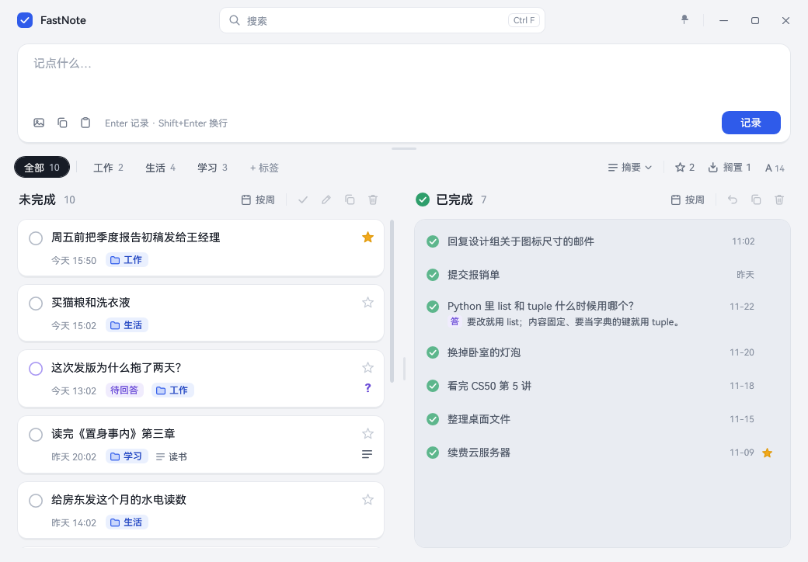
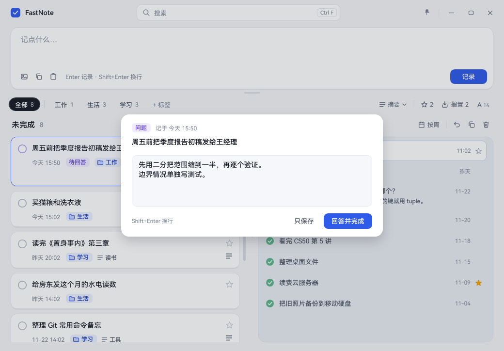
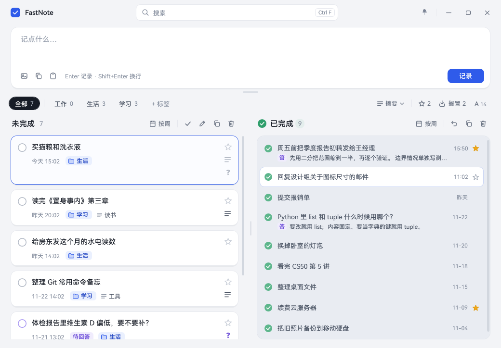
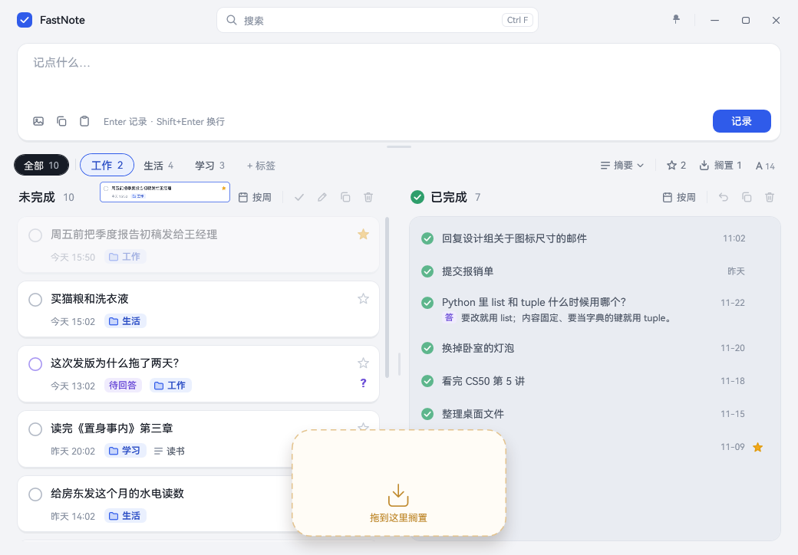
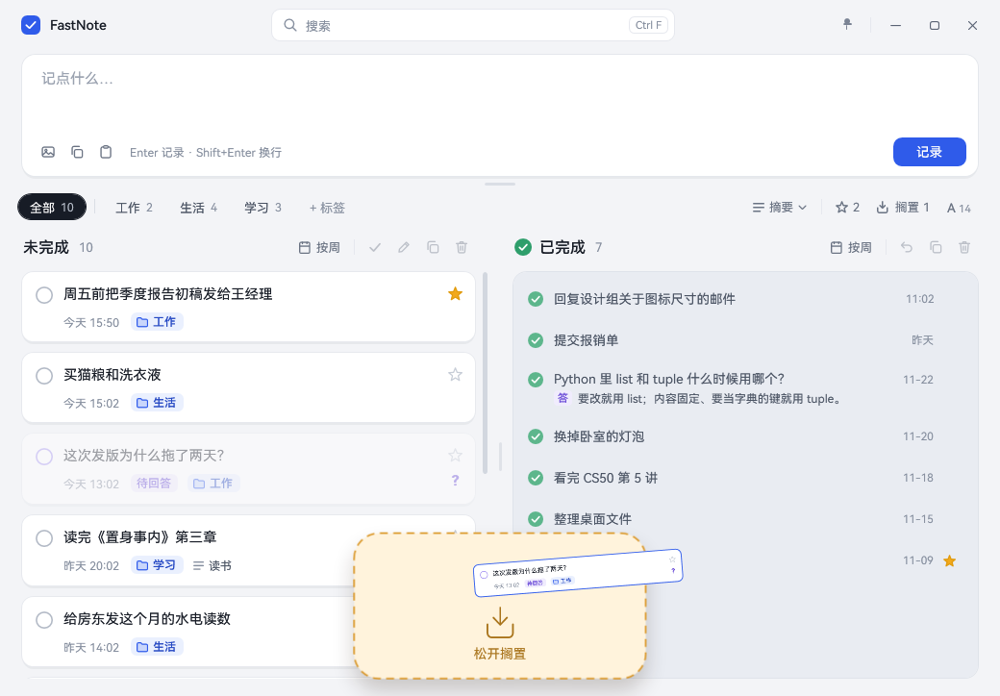

<div align="center">


<p>
  <a href="README.en.md"></a>
  &nbsp;
  <a href="README.md"></a>
</p>

<h1>FastNote</h1>

<p>A to-do list and scratchpad for Windows. Press Alt+Q, jot a line down, press Alt+Q again and it is gone.</p>

<p>
  <a href="https://github.com/zhshinichi/FastNote/releases"></a>
  
  
  <a href="LICENSE"></a>
  <a href="https://github.com/zhshinichi/FastNote/stargazers"></a>
</p>

<p>
  <a href="#download">Download</a> ·
  <a href="#writing-things-down">How it works</a> ·
  <a href="#keys">Keys</a> ·
  <a href="#data">Data</a> ·
  <a href="#building">Building</a>
</p>



</div>

Open items on the left, finished items on the right. Everything is kept in a plain text file on your own machine: no account, no network.

> The interface is in Simplified Chinese for now. Button names below are given in Chinese with a translation.

## Download

Get `FastNote-1.0.0-win-x64.zip` from [Releases](https://github.com/zhshinichi/FastNote/releases), unzip it anywhere and run `FastNote.exe`.

- Windows 10 / 11, 64-bit. The .NET runtime is included, nothing else to install.
- Keep the `Fonts` folder next to `FastNote.exe`, otherwise the app falls back to the system font.
- The exe is not code-signed, so the first launch may show "Windows protected your PC". Click "More info", then "Run anyway".

To start it with Windows: press Win+R, type `shell:startup`, create a shortcut to `FastNote.exe` in that folder and add ` --startup` at the end of its target. It then starts in the tray without opening a window.

## Writing things down

The box at the top is where you type. Press Enter and the item appears at the top of the left column.

- Shift+Enter for a new line, Ctrl+Enter to save and hide the window.
- Images work too: paste a screenshot with Ctrl+V, or use the picture button at the bottom left of the box.
- Close the window halfway through and the draft is still there next time.
- Drag the short bar under the box to make it taller or shorter.

## Finishing and restoring

Click the circle on the left of an item, or select it and press Enter. The circle gets a tick and the card flies over to 已完成 (Done). The next item is selected right away, so you can clear a run of items by pressing Enter repeatedly.

Select a finished item and press Enter (or use the restore button in the column header) to move it back.

## Questions and answers

Some items are not tasks but questions you asked yourself, like "Why was this release two days late?". Ticking those off is not enough; you want to write down the answer.

- Items ending in "?" or "？" become questions automatically and get a purple 待回答 (unanswered) badge.
- Any other item can be turned into a question: hover the card and click the small "?" on the right, right-click → 设为问题, or press Ctrl+Shift+Q.

Finishing a question opens an answer box, with the question on top and room for the answer below:



- 回答并完成 (answer and finish), or Enter: saves the answer and finishes the item as usual.
- 只保存 (just save): keeps the answer but leaves the item open. The card then shows 已回答 (answered) and the start of the answer.
- Esc or a click outside closes the box without finishing. Whatever you typed is still there when you open it again.
- An empty answer cannot finish a question.

Once finished, the answer is shown under the item in the Done column; double-click the row to edit it. Copying a question copies its answer too, and search looks inside answers.



## Tags

The row under the input box holds the tags: 全部 (All), your tags, and + 标签 (new tag).

- Click a tag and both columns show only what is in it. New items you write while standing in a tag go into that tag. Click 全部 or press Esc to go back.
- To file an item, drag its card onto a tag and let go, or right-click → 标签. One item lives in one tag, like a folder.



- Right-click a tag to rename or delete it. Deleting a tag keeps its items; they just lose the tag.
- Typing a tag name into the search box lists everything in that tag.

## Summaries

A summary (摘要) is a second level under tags, for example 读书 (reading) and 课程 (courses) under 学习 (study). Right-click a card → 摘要 to pick or create one. The 摘要 button on the right of the tag row opens the list of summaries to filter by. New items written while a tag and a summary are selected get both.

## Stars and shelving

Stars: click the star at the top right of a card to mark things you keep coming back to. The star button on the tag row (Ctrl+Shift+S) shows only starred items; its number is how many you have.

Shelving is for things that still need doing, just not now, so they stop crowding the open column. Press and drag a card and a tray appears at the bottom of the window; drop the card into it. Ctrl+Shift+P or right-click → 搁置 does the same.



The 搁置 (shelved) button on the tag row shows only shelved items; dragging a card into the tray from there takes it off the shelf. Shelved items still show up in search results. Press Esc mid-drag to cancel; dropping anywhere else sends the card back.

## By week

Each column has its own 按周 (by week) switch. With it on, the column is split into one small card per week showing the date range, this week / last week, and a count, with the first five items listed. 查看全部 N 条 → (show all N) opens that week inside the same column; 返回 (back) or Esc returns. A common setup is the open column by week and the done column as a plain list.

## Editing, deleting, copying

- Edit: select an item and press F2, or double-click an open card. Its text goes back into the input box; Enter saves, Esc cancels, and your unfinished draft comes back afterwards.
- Double-click a finished item to read the whole text.
- Delete: press Delete or use the bin in the column header. It asks first.
- Copy: the copy button in the header or right-click → 复制. Images are copied along with the text.

## Everything else

- Search (Ctrl+F) looks at text, tags, summaries and answers, and filters both columns.
- Text size: the "A" button on the tag row has four steps (14 / 16 / 18 / 21); Ctrl+wheel and Ctrl+= / Ctrl+- work too. Only the text you read gets bigger, the buttons and layout stay put.
- Drag the divider between the columns to change their widths.
- The pin button in the title bar keeps the window on top.
- Closing the window only sends it to the tray; the hotkey keeps working, and double-clicking the tray icon opens it too. The tray menu has 关于 (About: version, data folder, font notice) and 退出 (Quit).
- Column split, input box height, text size and pin state are remembered.

## Keys

| Key | Does |
| --- | --- |
| Alt+Q | Global: show / hide the window (can be changed, see below) |
| Enter | In the input box: save. On an open item: finish it (questions open the answer box first). On a finished item: restore it |
| Shift+Enter | New line |
| Ctrl+Enter | Save and hide the window |
| F2 | Edit the selected item |
| Delete | Delete the selected item |
| Ctrl+F | Search |
| Ctrl+Shift+S | Starred only |
| Ctrl+Shift+P | Shelve / unshelve |
| Ctrl+Shift+Q | Make it a question / a normal item |
| Ctrl+wheel, Ctrl+=, Ctrl+- | Text size |
| Esc | Steps back one level at a time: cancel a drag, cancel editing, leave the week view, clear search, leave the summary, leave the tag, leave shelved / starred, then hide the window |

### Changing the hotkey

Tray menu → 关于 → 打开数据文件夹 (open data folder), open `layout.ini` in Notepad and change the `Hotkey=Alt+Q` line, for example to `Hotkey=Ctrl+Alt+Space`. It needs at least one of Ctrl, Alt, Shift or Win, plus a letter, a digit, F1–F24 or Space. Quit FastNote from the tray and start it again. A value it cannot read falls back to Alt+Q, and if another program already owns the key, a tray notification says so.

## Data

Everything is in `%LOCALAPPDATA%\FastNote`; paste that into the Explorer address bar to open it. To back up or move to another PC, copy the whole folder.

| File | What |
| --- | --- |
| `ideas.tsv` | All items |
| `tags.txt` | Tags, one per line |
| `layout.ini` | Window layout, text size, hotkey |
| `todo-draft.txt`, `todo-draft.rich` | Whatever is still in the input box |
| `crash.log` | Errors, please attach it to bug reports |

`ideas.tsv` is UTF-8 text, one item per line, newest first, columns separated by tabs:

1. Time, `yyyyMMddHHmmss`
2. Done, `0` or `1`
3. Text, with `%`, tab, CR and LF written as `%25`, `%09`, `%0D`, `%0A`
4. For items with images, the full content (WPF XamlPackage, Base64); empty otherwise
5. Flags, comma separated: `star`, `shelved`, `question`, `a:` followed by the answer (UTF-8 as hex), `at:` followed by when it was answered
6. Tag (escaped like column 3)
7. Summary (escaped like column 3)

Trailing empty columns may be left out. Files are written to a temporary file first and then swapped in, so a power cut cannot leave half a file.

### Upgrading from Scratchpad

Before 1.0 the app was called Scratchpad and kept its data in `%LOCALAPPDATA%\Scratchpad`. On its first start FastNote copies that data over and leaves the old folder alone; delete it yourself once you are happy. If the old version is still running, FastNote asks it to quit first.

The old version does not know about questions and answers and drops them the next time it saves, so do not go back to it after upgrading.

## Building

Needs the [.NET 8 SDK](https://dotnet.microsoft.com/download/dotnet/8.0).

```
git clone https://github.com/zhshinichi/FastNote.git
cd FastNote
dotnet build -c Release
```

The same package as on the Releases page:

```
dotnet publish -c Release -r win-x64 --self-contained true -p:PublishSingleFile=true -o publish
```

Ship `FastNote.exe` together with the `Fonts` folder from `publish`.

### Self-tests

They only touch the folders you give them, never your real data:

```
FastNote.exe --selftest --data-dir=C:\temp\fn-store
FastNote.exe --uitest --data-dir=C:\temp\fn-ui --instance=test --uitest-drag=C:\temp\fn-ui-shots
FastNote.exe --exit --instance=test
```

- `--selftest` writes `ideas.tsv` and `layout.ini` and reads them back; the result is in `selftest.txt` in the data folder, and every value should be `True`.
- `--uitest` runs the window off screen, without taking focus or showing up in the taskbar. An empty data folder is filled with sample items first. `--uitest-drag` goes through dragging, finishing and answering, and writes screenshots and `drag-selftest.txt` to the folder you name; a first line of `ALL PASS` means everything passed. Close it afterwards with `--exit --instance=test`.
- `--uitest-capture=file.png` takes a single screenshot of the main window, which is how the pictures in this README were made.

## License

The code is MIT licensed, see [LICENSE](LICENSE).

The UI font, HarmonyOS Sans SC, is © Huawei Device Co., Ltd. and is shipped unmodified under the HarmonyOS Sans Fonts License Agreement, see [THIRD-PARTY-NOTICES.md](THIRD-PARTY-NOTICES.md).
