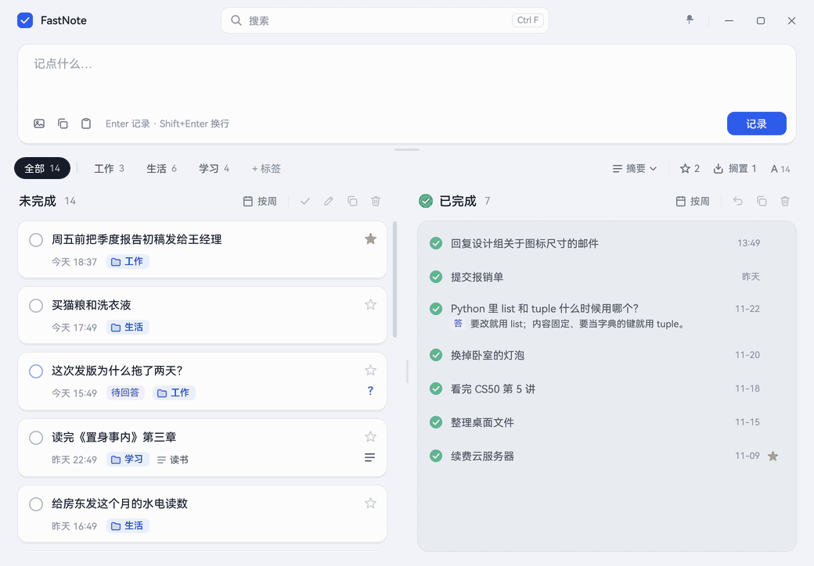
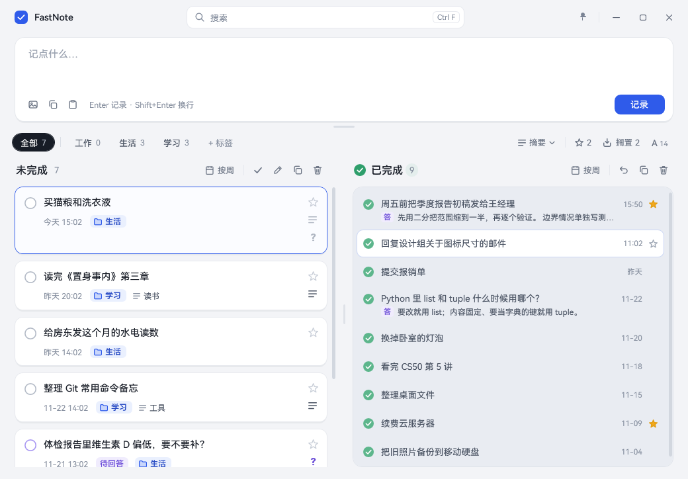
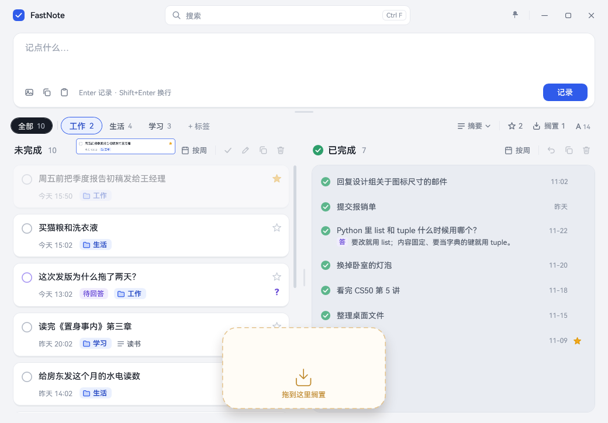

<div align="center">


<p>
  <a href="README.en.md"></a>
  &nbsp;
  <a href="README.md"></a>
</p>

<h1>FastNote</h1>

<p>Windows 上的待办和随手记。按 Alt+Q 叫出来，记一句，再按 Alt+Q 收回去。</p>

<p>
  <a href="https://github.com/zhshinichi/FastNote/releases"></a>
  
  
  <a href="LICENSE"></a>
  <a href="https://github.com/zhshinichi/FastNote/stargazers"></a>
</p>

<p>
  <a href="#下载">下载</a> ·
  <a href="#记东西">使用说明</a> ·
  <a href="#快捷键">快捷键</a> ·
  <a href="#数据">数据</a> ·
  <a href="#从源码编译">编译</a>
</p>



</div>

左边是还没做的，右边是做完的。所有东西都存在本地一个文本文件里，不联网，不用注册。

## 下载

到 [Releases](https://github.com/zhshinichi/FastNote/releases) 下载 `FastNote-1.0.0-win-x64.zip`，解压后运行 `FastNote.exe`。

- 支持 Windows 10 / 11（64 位），压缩包自带 .NET 运行时，不用另外安装。
- `Fonts` 文件夹要和 `FastNote.exe` 放在一起，否则会退回系统字体。
- 程序没有代码签名，第一次打开时 Windows 可能提示“已保护你的电脑”，点“更多信息”→“仍要运行”。
- 界面目前只有中文。

想开机自动启动：按 Win+R 输入 `shell:startup` 打开启动文件夹，在里面建一个 `FastNote.exe` 的快捷方式，在快捷方式的“目标”后面加上 ` --startup`。这样开机后它只待在托盘里，不弹窗口。

## 记东西

窗口顶部是输入框，写完按 Enter 就记下了，新事项出现在左栏最上面。

- Shift+Enter 换行，Ctrl+Enter 记下并收起窗口。
- 可以贴图片：直接 Ctrl+V，或者点输入框左下角的图片按钮。截图可以直接贴进来。
- 没写完就关掉窗口，草稿会留着，下次打开还在。
- 输入框下面那条短横线可以上下拖，调整输入框高度。

## 完成和恢复

点事项左边的圆圈，或者选中后按 Enter，就完成了。圆圈打勾，卡片飞到右边的“已完成”里。完成后会自动选中下一条，想连着清掉一串，就一直按 Enter。

在“已完成”里选中一条按 Enter，或者点栏头的恢复按钮，它就回到“未完成”。

## 问题和回答

有些事项不是任务，而是当时想到的问题，比如“这次发版为什么拖了两天？”。这种事项打个勾不够，要写下答案才算完。

- 以“？”或“?”结尾的事项，记下时会自动标成问题，卡片上有个紫色的“待回答”。
- 别的事项也可以手动设成问题：鼠标移到卡片上点右边的小“?”，或者右键选“设为问题”，或者按 Ctrl+Shift+Q。

完成一个问题时，会弹出回答框，上面是问题，下面写答案：


- “回答并完成”（或者按 Enter）：保存答案，然后像普通事项一样完成。
- “只保存”：答案先存着，事项留在未完成里，卡片上会显示“已回答”和答案的开头。
- Esc 或点框外面：先不答。已经写的内容会留着，下次打开回答框还在。
- 答案是空的不能完成。

完成后，答案显示在已完成那一行的下面。双击这一行可以修改答案。复制问题时会连答案一起复制，搜索也能搜到答案里的字。



## 标签

输入框下面那一排是标签：“全部”、你建的标签，还有“+ 标签”。

- 点一个标签，两栏就只显示这个标签里的事项。这时新记的事项会自动归进这个标签。点“全部”或按 Esc 回到全部。
- 给事项打标签：把卡片拖到标签上松手就行，也可以右键卡片选“标签”。一个事项只属于一个标签，用法像文件夹。



- 右键标签可以改名或删除。删掉标签不会删掉里面的事项，它们只是变成没有标签。
- 在搜索框里输入标签名，也能把这个标签里的事项都找出来。

## 摘要

摘要是标签下面的第二层分类，比如在“学习”下面再分“读书”“课程”。右键卡片选“摘要”，可以选一个已有的摘要或者新建一个。点标签栏右边的“摘要”会展开摘要列表，按摘要筛选。选着标签和摘要时新记的事项，会同时带上这两样。

## 星标和搁置

星标：点卡片右上角的星星，标出重要的、会反复用到的事项。标签栏右边的星标按钮（Ctrl+Shift+S）只显示带星标的事项，按钮上的数字是星标事项的总数。

搁置：不着急但以后还要做的事，放在未完成里会把真正要做的挤下去，可以先搁置。按住卡片拖一下，窗口底部会出现一个托盘，拖进去松开就搁置了。也可以选中后按 Ctrl+Shift+P，或者右键选“搁置”。


标签栏右边的“搁置”按钮会只显示搁置的事项，在这个视图里把卡片拖进托盘就是取消搁置。搜索的时候，搁置的事项也会出现在结果里。拖到一半按 Esc 可以取消，拖到别处松开会弹回原位。

## 按周看

两栏栏头各有一个“按周”按钮，可以分开开关。打开后，这一栏按周分成一张张小卡片，卡片头上写着日期范围、本周 / 上周和条数，每周先列 5 条。点“查看全部 N 条 →”会在原来那一栏里展开这一周，点“返回”或按 Esc 回来。常见的用法是左边按周翻，右边保持普通列表。

## 编辑、删除、复制

- 编辑：选中事项按 F2，或者双击未完成的卡片，内容会放回顶部输入框里改，Enter 保存，Esc 放弃。改完后，你原来没写完的草稿会回来。
- 已完成的事项双击可以看全文。
- 删除：选中后按 Delete，或者点栏头的垃圾桶，会先问一次。
- 复制：栏头的复制按钮或右键“复制”，带图片的事项会连图片一起复制。

## 其他

- 搜索（Ctrl+F）：会同时搜内容、标签、摘要和回答，两栏一起过滤。
- 字号：标签栏右边的“A”按钮有 14 / 16 / 18 / 21 四档，Ctrl+滚轮或 Ctrl+= / Ctrl+- 也能调。只放大要读的字，按钮和布局不跟着变。
- 两栏中间的分隔条可以拖，调整左右宽度。
- 标题栏的图钉按钮可以把窗口置顶。
- 关掉窗口只是收到托盘，热键照样能用，双击托盘图标也能打开。托盘右键菜单里有“关于”（版本号、数据在哪、字体说明）和“退出”。
- 两栏比例、输入框高度、字号、置顶都会记住。

## 快捷键

| 按键 | 作用 |
| --- | --- |
| Alt+Q | 全局：叫出 / 收起窗口（可以改，见下面） |
| Enter | 输入框里：记下。选中未完成的事项：完成，问题会先弹出回答框。选中已完成的事项：恢复 |
| Shift+Enter | 换行 |
| Ctrl+Enter | 记下并收起窗口 |
| F2 | 编辑选中的事项 |
| Delete | 删除选中的事项 |
| Ctrl+F | 搜索 |
| Ctrl+Shift+S | 只看星标 |
| Ctrl+Shift+P | 搁置 / 取消搁置 |
| Ctrl+Shift+Q | 设为问题 / 取消问题 |
| Ctrl+滚轮、Ctrl+=、Ctrl+- | 调字号 |
| Esc | 一层一层退回：取消拖动、取消编辑、退出周视图、清空搜索、退出摘要、退出标签、退出搁置和星标视图，最后收起窗口 |

### 改呼出热键

托盘右键 → 关于 → 打开数据文件夹，用记事本打开 `layout.ini`，找到 `Hotkey=Alt+Q` 这一行，改成你想要的，比如 `Hotkey=Ctrl+Alt+Space`。要至少带 Ctrl、Alt、Shift、Win 中的一个，按键可以是字母、数字、F1–F24 或 Space。改完从托盘退出 FastNote，再重新打开。写错了会用回 Alt+Q；热键被别的程序占用时，托盘会弹提示。

## 数据

数据都在 `%LOCALAPPDATA%\FastNote`，在资源管理器地址栏里输入这个就能打开。要备份或者换电脑，复制整个文件夹就行。

| 文件 | 内容 |
| --- | --- |
| `ideas.tsv` | 所有事项 |
| `tags.txt` | 标签，一行一个 |
| `layout.ini` | 窗口布局、字号、热键 |
| `todo-draft.txt`、`todo-draft.rich` | 输入框里还没记下的草稿 |
| `crash.log` | 出错时的记录，报 bug 时请附上 |

`ideas.tsv` 是 UTF-8 文本，一行一个事项，从新到旧排列，列之间用 Tab 分开：

1. 时间，格式 `yyyyMMddHHmmss`
2. 是否完成，`0` 或 `1`
3. 内容。其中的 `%`、Tab、回车、换行写成 `%25`、`%09`、`%0D`、`%0A`
4. 带图片的事项在这一列存完整内容（WPF XamlPackage，Base64），没有图片就空着
5. 标记，用逗号分开：`star` 星标、`shelved` 搁置、`question` 问题、`a:` 后面跟回答（UTF-8 转十六进制）、`at:` 后面跟回答时间
6. 标签（转义同第 3 列）
7. 摘要（转义同第 3 列）

后面几列都是空的时候可以不写。

## 从源码编译

需要 [.NET 8 SDK](https://dotnet.microsoft.com/download/dotnet/8.0)。

```
git clone https://github.com/zhshinichi/FastNote.git
cd FastNote
dotnet build -c Release
```

打成和 Releases 里一样的包：

```
dotnet publish -c Release -r win-x64 --self-contained true -p:PublishSingleFile=true -o publish
```

`publish` 文件夹里的 `FastNote.exe` 和 `Fonts` 要一起打包。

### 自测

自测的数据放在 `--data-dir` 指定的文件夹里：

```
FastNote.exe --selftest --data-dir=C:\temp\fn-store
FastNote.exe --uitest --data-dir=C:\temp\fn-ui --instance=test --uitest-drag=C:\temp\fn-ui-shots
FastNote.exe --exit --instance=test
```

- `--selftest` 把 `ideas.tsv` 和 `layout.ini` 写一遍再读回来，结果在数据文件夹的 `selftest.txt` 里，每项都应该是 `True`。
- `--uitest` 在屏幕外开一个窗口跑。数据文件夹是空的时，会先写入一组示例事项。`--uitest-drag` 会跑一遍拖动、完成、回答，截图和 `drag-selftest.txt` 存到指定文件夹，第一行是 `ALL PASS` 就是都通过了。跑完用 `--exit --instance=test` 关掉。
- `--uitest-demo=文件夹` 用示例数据演一遍记下、完成、归类、搁置、回答，每 40 毫秒存一帧。
- `--uitest-capture=文件.png` 只截一张主窗口。

## 许可

代码以 MIT 许可发布，见 [LICENSE](LICENSE)。

界面字体是 HarmonyOS Sans SC，版权归华为终端有限公司所有，依照 HarmonyOS Sans Fonts License Agreement 随程序分发，没有修改，见 [THIRD-PARTY-NOTICES.md](THIRD-PARTY-NOTICES.md)。
